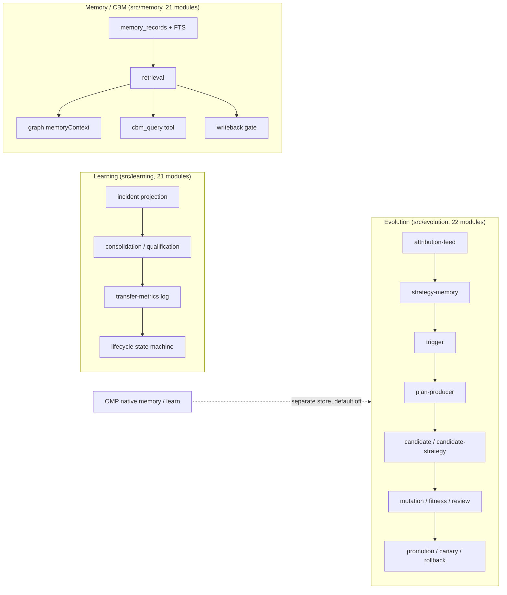

# Self-evolution architecture — as implemented at `1301bb1`

**Card:** `AEGISFLOW_SELF_EVOLUTION_EFFECTIVENESS_AUDIT_1`
**Mode:** READ-ONLY. No source, config, store, skill or prompt was modified.
**Baseline:** `1301bb1` = `origin/audit/omp-native-capability-dispatch-1`; `origin/main` = `1cf1e9f`.

This document describes **what the code does**, not what it claims. Every statement
is tied to `path:line`. Where a mechanism exists but is unreachable in normal
operation, that is stated here and quantified in
`LEARNING_AND_MEMORY_UTILIZATION.md`.

---

## 1. Three separate subsystems, one shared name

"Self-evolution" in this repository is not one system. It is three systems with
different storage, authority and activation state:



| Subsystem | Size | Production activation default |
|---|---:|---|
| `src/evolution/**` | 22 modules / 6,684 lines | **OFF** — requires three declared inputs; none are present on this host |
| `src/learning/**` | 21 modules / 11,873 lines | **HARD-DISABLED** — `TRANSFER_METRICS_ENABLED = false` |
| `src/memory/**` (CBM) | 21 modules / 5,364 lines | read path callable; **no production caller constructs the provider at HEAD** |

Source sizes are `find … -name '*.mjs' | wc -l` / concatenated line counts at
`1301bb1`.

---

## 2. Evolution pipeline and its single production entry

### 2.1 Entry point

The only production chain is:

```
caller → runAdmittedGraph (src/admission/admission-gate.mjs:227)
       → runner result
       → feedStrategyObservationForProduction      :408
       → observeRunForEvolutionTriggers            :420
       → consumeEvolutionObservationForProduction  :430
       → (only when a qualified, un-gated trigger exists)
         dynamic import("./loop.mjs") + runEvolutionCycle   src/evolution/production-consumer.mjs:495-496
```

`runEvolutionCycle` is **scheduled, never awaited** (`production-consumer.mjs`
header :20-23), so a cycle cannot change the run's verdict. The whole block is
wrapped in `try { … } catch {}` (`admission-gate.mjs:397-441`): evolution failure
is observability loss only.

There is no scheduler, launchd job, cron entry or CLI that runs a cycle.
`scripts/evolution-*.mjs` only issue policy, inspect state, toggle the kill
switch or write the declaration. The one-shot governed launcher and
`scripts/pi-aegisflow.sh` do not mention evolution.

### 2.2 Configuration gate — the reason nothing runs today

`resolveEvolutionProductionConfig` (`production-consumer.mjs:161-211`) is
**INERT unless all three of `storeRoot`, `checkpointRoot`, `repoRoot` resolve**,
in precedence order: `runnerOpts.evolution` → `AEGISFLOW_EVOLUTION_*` env →
deployment declaration file (`AEGISFLOW_EVOLUTION_DEPLOYMENT_CONFIG`).

Measured:

| Input | Observed |
|---|---|
| `AEGISFLOW_EVOLUTION_*` in shell / launcher / LaunchAgents | none |
| `AEGISFLOW_EVOLUTION_DEPLOYMENT_CONFIG` in shell | unset |
| `runnerOpts.evolution` from the production dispatcher | not passed (`src/control-plane/coordinator.mjs:446-518` forwards `task.runnerOpts` only) |
| Result of `resolveEvolutionProductionConfig({env:{}})` | `{enabled:false, missing:["storeRoot","checkpointRoot","repoRoot"]}` |
| Result with the declaration file supplied | `{enabled:true, storeRoot:"…/autoloop-evolution", dims:["MODEL_ROUTING","RETRY_REPAIR"]}` |

So the production path is **declared-but-not-active**: the declaration exists on
disk, but no live process exports it. This is a configuration boundary, not a
defect proven by this card.

### 2.3 Policy

- Artifact: `<store>/evolution-policy.json` (`policy.mjs:70`); generations
  archived at `<store>/evolution-policy-history/gen-N-<id>.json`
  (`policy.mjs:239-244`).
- Issued only by `createEvolutionPolicy` / `issueSuccessorEvolutionPolicy`
  (`policy.mjs:167,343`), invoked from an operator CLI
  (`scripts/evolution-issue-policy.mjs`).
- Validation is fail-closed: schema keys, digest re-derivation, mandatory
  forbidden globs (`src/governance/**`, `src/admission/**`, `src/evolution/**`,
  `.git/**`, `docs/governance/**`), all eight HIGH risk classes required in
  `forbidden_risk_classes`, expiry check (`policy.mjs:88-164, 200-215`).
- Strategy dimensions are **ABSENT unless declared**; an undeclared dimension
  refuses a `strategy://` candidate (`policy.mjs:505-509`).
- `PROMPT_EVOLUTION` is MEDIUM (`candidate-strategy.mjs:34,65`) and the issuance
  lane refuses it (`scripts/evolution-issue-policy.mjs:81-96`).

Measured production artifacts (`/Volumes/NVM2T/Development/evidence/autoloop-evolution`):

| File | Content |
|---|---|
| `evolution-policy.gen0.json` | gen 0, no strategy dimensions |
| `evolution-policy.json` | gen 1, `risk_classes_allowed:["LOW"]`, `strategy_dimensions_allowed:["MODEL_ROUTING","RETRY_REPAIR"]`, `issued_by: operator:autoloop-agent-strategy-evolution-production-activation-1`, expires `2026-10-24T10:56:29.996Z` |
| `production-declaration.json` | storeRoot / checkpointRoot / repoRoot / taskClass `AUTOLOOP_CARD` / baselines / reviewer `reviewer:evolution-fitness-gate` |

No `evolution-policy-history/` directory exists (gen 1 was created before the
successor archive path; gen 0 keeps its legacy filename).

### 2.4 Trigger

Seven closed signal classes with floors 3/3/3/5/3/3/1
(`trigger.mjs:47-77`). Floors can only be raised (`Math.max`, `:262`).
Gates: dedup, cooldown (6 h), frequency cap (3/24 h), circuit breaker
(`trigger.mjs:457-484`, defaults `:87-89`).

Two reachability facts measured in the production path:

1. **Window parameter is not propagated.** `extractTriggerObservations` accepts
   `windowMs`, but the observer calls it with `{ events }` only
   (`production-observer.mjs:170`), so the fixed 24 h default applies and a
   per-class policy window is never honoured.
2. **Three classes cannot fire in production.** `LATENCY_REGRESSION`,
   `TOKEN_INEFFICIENCY` and `QUALIFIED_PATTERN_EVIDENCE` require
   `latencyBaseline` / `tokenBaseline` / `qualifiedPatterns`; the gate supplies
   none (`admission-gate.mjs:420-428`), so those classes evaluate against
   `null`.

### 2.5 Candidate, fitness, review, promotion, canary

| Stage | Module | What is written |
|---|---|---|
| Candidate (source) | `candidate.mjs` | `<store>/evolution-candidates/<id>.json` + `evolution-derivation-index.json` (`:67-76,291-294`) |
| Candidate (strategy) | `candidate-strategy.mjs` | **nothing persisted** — returns `{status:"CREATED", candidate}` (`:214`) |
| Mutation (source) | `mutation.mjs` | isolated C3B worktree; production checkout untouched (`:1-30`) |
| Fitness | `fitness.mjs` / `fitness-strategy.mjs` | in-memory decision; strategy requires ≥3 samples (`fitness-strategy.mjs:41-45`) |
| Review | `promotion.mjs:174-190` | `<store>/reviews/<candidate>.json` |
| Promotion (source) | `promotion.mjs` | branch `evolution/<candidate_id>`; `main`/`master` refused (`:88-116`) |
| Promotion (strategy) | `loop.mjs:478-500` | `activateStrategyValue` → `<store>/strategy-policy.json` |
| Canary | `canary.mjs` | `<store>/canary/<candidate>.json`; floor ≥30 min |
| Rollback | `canary.mjs:212-260` | ref restore (source) or deactivation (strategy) |

Promotion gates are conjunctive and fail closed
(`promotion.mjs` header :12-30): policy preauthorization, risk class, fitness
PASS, regression PASS, independent review PASS, digest re-derivation, live HEAD
equality, semantic drift. MEDIUM requires operator promotion; HIGH is refused
before mutation.

### 2.6 State files by path

| Path | Writer |
|---|---|
| `<store>/attribution-feed.json` | `attribution-feed.mjs:108` |
| `<store>/strategy-memory.json` | `strategy-memory.mjs:58` |
| `<store>/strategy-policy.json` | `strategy-store.mjs:159` |
| `<store>/evolution-trigger-state.json` | `trigger.mjs:404-417` |
| `<store>/evolution-candidates/` | `candidate.mjs:291` |
| `<store>/reviews/` | `promotion.mjs:174` |
| `<store>/canary/` | `canary.mjs:62` |
| `<store>/evolution-cycles/` | `production-consumer.mjs:381` |
| `<store>/evolution-suspended.json` | `kill-switch.mjs:37` |
| `<store>/evolution-policy-history/` | `policy.mjs:242` |

Only the first three files are written **before** a trigger fires
(attribution feed is unconditional once configured: `attribution-feed.mjs:293`).

---

## 3. Learning subsystem (measurement plane, disabled)

- `src/learning/incidents/projection.mjs` builds an ephemeral,
  `NON_AUTHORITATIVE` incident projection (`:1-9,1092`).
- `src/learning/incidents/lifecycle-terminal-adapter.mjs` states "Not a
  production emitter" (`:4`) and returns `UNAVAILABLE` without a writer
  (`:681-682,749-750`).
- The unique production seam is hard-disabled:

```js
// src/learning/transfer-metrics/seam.mjs:5-11
// Unique production integration seam. Hardcoded disabled.
// No env, CLI, config, remote, or test-credential override exists.
export const TRANSFER_METRICS_ENABLED = false;
export const PRODUCTION_EFFECT = "NO_PRODUCTION_EFFECT";
```

Measured: `recordTransferEvent()` returns `DISABLED`; `getTransferMetricsWriter()`
returns `null`.

- Consolidation/qualification (`src/learning/patterns/*`) have no non-test
  importer. The one learning module that reaches production semantics is
  `applicability.mjs`, imported by retrieval (`src/memory/retrieval.mjs:50,540`).
- The Stage-F lifecycle state machine is wired into the writeback gate only for
  `PATTERN + CREATE + provenance.lifecycle`; no production producer sets that
  provenance (`src/memory/writeback/gate.mjs:416-436`).

---

## 4. Memory / CBM subsystem

- Store: SQLite at `<AEGISFLOW_HOME>/memory/memory.db`, default
  `~/.autoloop/memory` (`src/memory/local-store.mjs:57`), plus a JSONL journal.
- Record types `CODE|EXECUTION|DECISION|PATTERN`; trust ladder
  `RAW<UNVERIFIED<VERIFIED<REVIEWED<CONFIRMED`; validity
  `CURRENT|STALE|INVALIDATED|TOMBSTONED|CONFLICTED` (`contract.mjs:11,41,50`).
- Retrieval is deterministic, bounded, and DATA-only (`graph-context.mjs:1-32`).
- Writeback is gated by `admission.memory_policy.writeback_allowed === true`
  (`colima-graph-runner.mjs:878-890`) and by a source/trust matrix
  (`src/memory/writeback/source-map.mjs`).
- The graph runner performs retrieval only when a caller supplies
  `memory.provider` **and** the admission authorises it
  (`colima-graph-runner.mjs:249`).

**Important lineage fact.** Commit `251d9ae` added automatic provider
construction inside `runAdmittedGraph` ("Phase 2: runAdmittedGraph constructs
the read-only memory provider at ONE site"). That commit is **not an ancestor of
`1301bb1`** (`git merge-base --is-ancestor 251d9ae HEAD` → false; the branch
containing it is `origin/governance/decomp-opt1-design-freeze`), and the
current gate contains no `createGraphMemoryProvider` call. Repo-wide, the
factory's only callers are tests. So the published "production provider wiring"
is absent from the current lineage, and production retrieval is caller-supplied
only.

The OMP-facing surface is `cbm_query`
(`integrations/omp/extensions/cbm-query.js:43,310-355`): read-only, DATA-only,
same engine as the CLI, deployed byte-identical
(`shasum` matches the repository copy).

---

## 5. OMP native capabilities in the same space

| Capability | OMP native | AegisFlow | Boundary |
|---|---|---|---|
| Durable memory | `memory.backend` `off|local|hindsight|mnemopi|sharpshooter`, **default off** | CBM SQLite + journal | separate stores; no shared code |
| Recall / retain | `recall` / `retain` tools, backend-gated | `cbm_query`; writeback gate | conceptual duplication only |
| Learn / skill authoring | `learn`, `manage_skill`, `AutoLearnController` → `~/.omp/agent/managed-skills` | **none** — repo contains no skill writer and no `SKILL.md` | no overlap |
| Prompt evolution | none | `PROMPT_EVOLUTION` is a declared token, MEDIUM, never prompt text | nominal only |

Measured on this host: `~/.omp/agent/config.yml` has no `memory:` or `autolearn:`
keys; 0 calls to `memory_recall`, `memory_retain`, `memory_reflect`,
`memory_edit`, `learn`, `manage_skill` across 1,740 session files;
`cbm_query` = **1** call (2026-10-18, session
`--private-tmp-aegis-work--/2026-10-18T13-56-36-732Z_01a14f4c…jsonl`).

---

## 6. What the architecture does not contain

- No component writes OMP skills, prompts, `config.yml`, `mcp.json` or settings.
- No scheduler or daemon starts an evolution cycle.
- No production caller consumes `resolveProductionRoute` /
  `resolveStrategyPreference` (only `benchmarks/runner/run-benchmark.mjs:105,142`
  and tests).
- No operator path clears a tripped circuit breaker: `clearCircuitBreaker`
  (`trigger.mjs:508`) has zero call sites.
- No strategy candidate artifact is persisted (`candidate-strategy.mjs:214`).
- No automatic expiry handling beyond a HOLD: after `2026-10-24T10:56:29Z`
  `readEvolutionPolicy` throws `EVOLUTION_POLICY_EXPIRED`
  (`policy.mjs:208-209`) and the consumer reports `POLICY_UNAVAILABLE`.
